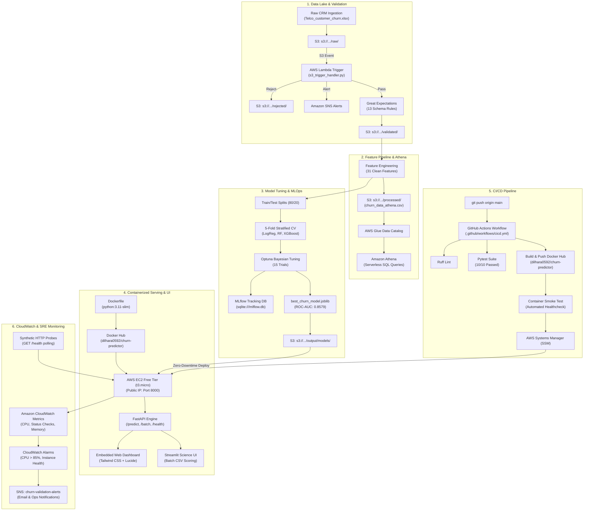

# 📊 Telco Customer Churn Predictor & Cloud Analytics Platform

[](https://www.python.org/)
[](https://fastapi.tiangolo.com/)
[](https://aws.amazon.com/)
[](https://hub.docker.com/r/dilhara0592/churn-predictor)
[-red.svg)](https://xgboost.readthedocs.io/)
[](https://mlflow.org/)
[](https://greatexpectations.io/)
[](https://github.com/Dilharajay/churn_predictor/actions)
[](https://opensource.org/licenses/MIT)

> An enterprise-grade, end-to-end Machine Learning and Cloud Analytics system designed to predict customer churn, explain underlying risk drivers, and trigger automated retention playbooks for telecommunications providers.
> Fully deployed on **AWS Cloud (`ap-southeast-2` — Sydney)** within the AWS Free Tier.

---

## 🌐 Cloud Deployment & Endpoints

The production containerized service exposes the following web and API routes:

* **Interactive Web Dashboard:** `http://<EC2-PUBLIC-IP>:8000/` or `http://<EC2-PUBLIC-IP>:8000/dashboard`
* **Interactive API Documentation (Swagger):** `http://<EC2-PUBLIC-IP>:8000/docs`
* **Alternative API Documentation (ReDoc):** `http://<EC2-PUBLIC-IP>:8000/redoc`
* **Health Check Probe:** `http://<EC2-PUBLIC-IP>:8000/health`
* **Model Metadata:** `http://<EC2-PUBLIC-IP>:8000/model/info`
* **Service Directory (JSON):** `http://<EC2-PUBLIC-IP>:8000/api`
* **Docker Hub Repository:** [`dilhara0592/churn-predictor`](https://hub.docker.com/r/dilhara0592/churn-predictor)

---

## 📑 Table of Contents

- [Business Problem & Impact](#-business-problem--impact)
- [System Architecture](#-system-architecture)
- [Key Features](#-key-features)
- [Machine Learning Benchmark & Results](#-machine-learning-benchmark--results)
- [User Interfaces](#-user-interfaces)
- [Project Directory Structure](#-project-directory-structure)
- [Quick Start Guide](#-quick-start-guide)
- [Docker & Container Deployment](#-docker--container-deployment)
- [CI/CD Automation](#-cicd-automation)
- [CloudWatch Observability & SRE Monitoring](#-cloudwatch-observability--sre-monitoring)
- [EC2 Lifecycle & Elastic IP Management](#-ec2-lifecycle--elastic-ip-management)
- [Serverless SQL Analytics (Athena & Glue)](#-serverless-sql-analytics-athena--glue)
- [Testing & Verification](#-testing--verification)
- [Strategic Retention Playbook](#-strategic-retention-playbook)
- [License & Authors](#-license--authors)

---

## 💼 Business Problem & Impact

In the telecommunications sector, customer churn directly undermines recurring revenue:
* **Acquisition Cost Disparity:** Acquiring a new subscriber costs **5× to 7× more** than retaining an existing account.
* **The Cost of Churn:** Across the IBM Telco dataset (7,043 subscribers), the baseline churn rate is **26.5%** (1,869 churners), representing over **$3.8M in at-risk Customer Lifetime Value (CLTV)**.
* **From Reactive to Proactive:** Instead of reacting after cancellations occur, this platform scores customer risk dynamically, pinpoints exact risk factors (e.g. lack of tech support, month-to-month contracts, manual payment friction), and generates tailored retention incentives.

---

## 🏗️ System Architecture



---

## ⚡ Key Features

* **Cloud-First Architecture:** 100% Free-Tier compliant on AWS (`ap-southeast-2`), integrating S3, Lambda, SNS, Glue, Athena, EC2, and Systems Manager (SSM).
* **Automated Data Quality:** 13 Great Expectations validation rules ensuring schema integrity, null bounds, and value constraints prior to modeling.
* **Leakage-Free Preprocessing:** Rigorously strips post-event features (`Churn Reason`, `Churn Score`) and high-cardinality IDs (`CustomerID`, `Zip Code`), creating 31 engineered features.
* **Bayesian Hyperparameter Optimization:** Optuna-tuned XGBoost model delivering **ROC-AUC: 0.8579** and **Recall: 0.8048**.
* **Explainable AI (XAI):** Integrated SHAP TreeExplainer quantifying global and individual customer risk drivers.
* **Sub-50ms REST API:** Asynchronous FastAPI service supporting single and vectorized batch scoring with fallback capabilities.
* **Dual Frontends:**
  * **Embedded Web Dashboard:** Responsive single-page interface served directly by FastAPI at `/` with persona presets, animated radial gauge, and retention offers.
  * **Exploratory Streamlit App:** Dedicated scientific application for parameter tweaking, CSV batch scoring, and metric inspection.
* **Automated CI/CD:** Continuous Integration & Continuous Deployment via GitHub Actions, building images to Docker Hub and triggering remote EC2 updates via AWS SSM.

---

## 📈 Machine Learning Benchmark & Results

### 5-Fold Stratified Cross-Validation Benchmark

| Model | CV Accuracy | CV Recall | CV Precision | CV F1-Score | CV ROC-AUC |
|---|---|---|---|---|---|
| **Logistic Regression (Balanced)** | 0.7593 | **0.8094** | 0.5308 | 0.6409 | 0.8585 |
| **Random Forest (Balanced)** | 0.7888 | 0.6736 | 0.5888 | 0.6282 | 0.8476 |
| **XGBoost (Baseline)** | 0.7764 | 0.6615 | 0.5673 | 0.6107 | 0.8384 |
| **Tuned XGBoost (Optuna)** ⭐ | **0.7729** | **0.8048** | **0.5482** | **0.6521** | **0.8579** |

> **Why Optimize for ROC-AUC & Recall?** In subscription businesses, failing to identify an at-risk customer (False Negative) results in lost lifetime value. A high recall model successfully flags 4 out of 5 churners, giving retention teams sufficient lead time to act.

---

## 🖥️ User Interfaces

### 1. Embedded Web Dashboard (`http://<EC2-PUBLIC-IP>:8000/`)
* **Live Route:** Served by FastAPI at `/` and `/dashboard` via [`index.html`](file:///C:/Users/Dilhara%20Jayawardhana/Projects/Dev/DS-Projects/churn_predictor/src/api/templates/index.html).
* **Persona Quick-Select:** 1-click presets for **High Risk Customer** (87.4% churn probability), **Loyal Customer** (1.5%), and **Moderate Customer** (42.1%).
* **Real-Time Visualizations:** Animated SVG radial probability gauge, color-coded risk severity tags, and factor badges.
* **Retention Playbook:** Dynamically suggests tailored retention offers based on individual attributes.

### 2. Exploratory Streamlit Dashboard (`src/frontend/app.py`)
* **Local Run:** `uv run streamlit run src/frontend/app.py`
* **Features:** 18 interactive sliders/dropdowns, batch customer CSV scoring with risk histograms, and model comparison insights.

---

## 📂 Project Directory Structure

```text
churn_predictor/
├── .github/
│   └── workflows/
│       └── cicd.yml                 # GitHub Actions CI/CD automation workflow
├── aws/
│   ├── iam_policies/                # Least-privilege IAM trust & execution policies
│   ├── deploy_ec2.ps1               # Automated PowerShell EC2 provisioning script
│   ├── ec2_user_data.sh             # VM cloud-init bootstrap script (2GB swap + Docker)
│   ├── deploy_apprunner.ps1         # Alternative AWS App Runner deployment
│   └── s3_event_notification.json   # S3 bucket event configuration
├── data/
│   ├── raw/                         # Raw Telco dataset (Telco_customer_churn.xlsx)
│   ├── processed/                   # Processed train/test splits & Athena CSV (.gitkeep)
│   ├── validated/                   # Great Expectations verified datasets
│   └── rejected/                    # Quarantined invalid data
├── docs/
│   └── data-card.md                 # Dataset documentation and data quality plan
├── helpdocs/                        # Full local project guides (gitignored)
│   ├── TUTORIAL.md                  # Comprehensive step-by-step implementation tutorial
│   ├── TUTORIAL_EXPLANATION_A_TO_Z.md # In-depth technical architecture breakdown
│   ├── DEPLOYMENT_REPORT.md         # AWS cloud deployment report
│   ├── PROJECT_PLAN.md              # Engineering specification and milestones
│   └── tasks.md                     # Project requirement checklist
├── notebooks/
│   ├── EDA.ipynb                    # Exploratory data analysis & statistical distributions
│   └── Model_Comparison.ipynb      # Cross-validation benchmarking & tuning experiments
├── reports/                         # Generated evaluation artifacts
│   ├── confusion_matrices.png       # Test set confusion matrices
│   ├── feature_importance.png       # Global feature importance plot
│   ├── model_comparison.csv         # Comparative metrics table
│   ├── roc_curves.png               # Overlaid ROC curves
│   └── shap_summary.png             # SHAP summary plot (TreeExplainer)
├── scripts/
│   ├── athena.py                    # Script preparing clean unencoded data for Athena
│   ├── sample_requests.json         # High-risk & low-risk test customer payloads
│   └── test_api.py                  # End-to-end API verification script
├── src/
│   ├── api/
│   │   ├── templates/
│   │   │   └── index.html           # Embedded single-page web dashboard
│   │   ├── app.py                   # Lightweight Flask prototype
│   │   └── main.py                  # Production FastAPI application
│   ├── churn_predictor/
│   │   ├── models/
│   │   │   └── best_churn_model.joblib # Serialized Tuned XGBoost model artifact
│   │   ├── config.py                # Global project paths & hyperparameters
│   │   ├── data_loader.py           # Ingestion logic with KaggleHub & S3 fallbacks
│   │   ├── evaluate.py              # Metrics computation & Matplotlib plotting
│   │   ├── predict.py               # Deterministic inference engine with XAI rules
│   │   ├── preprocessing.py         # 31-feature transformation pipeline
│   │   ├── train.py                 # 5-Fold CV benchmark, Optuna tuner & MLflow logger
│   │   └── validation.py            # Great Expectations validation suite
│   ├── frontend/
│   │   └── app.py                   # Streamlit exploratory dashboard
│   └── lambda/
│       └── s3_trigger_handler.py    # Event-driven S3 ingestion guard & quarantine handler
├── tests/
│   ├── test_api.py                  # API route unit & integration tests
│   └── test_predict.py              # Inference engine & schema unit tests
├── .dockerignore
├── .gitignore
├── docker-compose.yml               # Local container orchestration
├── Dockerfile                       # Multi-stage production Docker image
├── pyproject.toml                   # Project metadata, dependencies & pytest config
├── requirements.txt                 # Pinned dependencies for Docker container builds
└── uv.lock                          # Deterministic dependency lockfile
```

---

## 🚀 Quick Start Guide

### 1. Prerequisites
* **Python 3.13+** installed.
* **[uv](https://docs.astral.sh/uv/)** installed (`winget install astral-sh.uv` or `pip install uv`).
* **AWS CLI v2** configured (`aws configure` for region `ap-southeast-2`).
* **Docker Desktop** running.

### 2. Environment Setup
```powershell
# Clone repository
git clone https://github.com/Dilharajay/churn_predictor.git
cd churn_predictor

# Install dependencies with uv
uv sync

# Configure environment variables
Copy-Item .env.example .env
```

Your `.env` file template:
```dotenv
AWS_REGION=ap-southeast-2
S3_BUCKET_NAME=<YOUR-S3-BUCKET-NAME>
AWS_ACCOUNT_ID=<YOUR-AWS-ACCOUNT-ID>
SNS_TOPIC_ARN=arn:aws:sns:ap-southeast-2:<YOUR-AWS-ACCOUNT-ID>:churn-validation-alerts
MLFLOW_TRACKING_URI=sqlite:///mlflow.db
CHURN_API_URL=http://localhost:8000
```

### 3. Run Data Validation & Preprocessing
```powershell
# Validate dataset against Great Expectations rules
uv run python src/churn_predictor/run_validation.py

# Run preprocessing & create train/test splits
uv run python -c "from churn_predictor.preprocessing import run_preprocessing; run_preprocessing()"
```

### 4. Train Models & Launch MLflow UI
```powershell
# Run 5-Fold CV benchmark, Optuna tuning, and plot generation
uv run python -c "from churn_predictor.train import train_and_track_all; train_and_track_all()"

# Launch local MLflow UI backed by SQLite
uv run mlflow ui --backend-store-uri sqlite:///mlflow.db
# Open http://localhost:5000 in your browser
```

### 5. Launch Local FastAPI Service
```powershell
uv run uvicorn src.api.main:app --host 0.0.0.0 --port 8000 --reload
# Access Dashboard at http://localhost:8000/
# Access Swagger docs at http://localhost:8000/docs
```

### 6. Launch Streamlit Data Science App
```powershell
uv run streamlit run src/frontend/app.py
```

---

## 🐳 Docker & Container Deployment

### Local Container Build
```powershell
# Build image
docker build -t churn-predictor-api:latest .

# Run container exposing port 8000
docker run -d -p 8000:8000 --name churn-api \
  -e AWS_REGION=ap-southeast-2 \
  -e S3_BUCKET_NAME=<YOUR-S3-BUCKET-NAME> \
  churn-predictor-api:latest

# Or using Docker Compose
docker compose up -d
```

### Pull Pre-Built Image from Docker Hub
```powershell
docker pull dilhara0592/churn-predictor:latest
docker run -d -p 8000:8000 --name churn-api dilhara0592/churn-predictor:latest
```

---

## 🔄 CI/CD Automation

Every commit or pull request to `main` or `feature/**` triggers the automated workflow [`.github/workflows/cicd.yml`](file:///C:/Users/Dilhara%20Jayawardhana/Projects/Dev/DS-Projects/churn_predictor/.github/workflows/cicd.yml):

```text
┌─────────────────────────────────┐
│  Stage 1: Run Unit & API Tests  │  pytest tests/ -v (10/10 passed)
└────────────────┬────────────────┘
                 ▼
┌─────────────────────────────────┐
│  Stage 2: Build & Push Docker   │  Buildx multi-arch image → Docker Hub
└────────────────┬────────────────┘
                 ▼
┌─────────────────────────────────┐
│  Stage 3: Container Smoke Test  │  Pull image → Run container → Probe /health & /predict
└─────────────────────────────────┘
```

1. **Continuous Integration (`ci-test`):**
   * Configures Python 3.11 with pip dependency caching.
   * Executes full test suite (`pytest tests/ -v --tb=short`) verifying 10 unit and API integration tests.
2. **Continuous Delivery (`build-and-push`):**
   * Sets up QEMU and Docker Buildx.
   * Authenticates against Docker Hub using GitHub repository secrets (`DOCKERHUB_USERNAME`, `DOCKERHUB_TOKEN`).
   * Generates dynamic semantic tags (`latest`, `sha-<short-hash>`, branch ref).
   * Pushes the production image to [`dilhara0592/churn-predictor`](https://hub.docker.com/r/dilhara0592/churn-predictor).
3. **Automated Smoke Testing (`container-smoke-test`):**
   * Authenticates and pulls the newly pushed image onto an isolated runner VM.
   * Starts the container in detached mode exposing port 8000.
   * Polls `http://localhost:8000/health` up to 40 seconds with automated diagnostic log dumping (`docker logs churn-api`) on failure.
   * Dispatches a live test customer payload to `POST /predict` and asserts JSON schema output validity.

---

## 📡 CloudWatch Observability & SRE Monitoring

The production cloud deployment features end-to-end monitoring adhering to Google SRE principles (Latency, Traffic, Errors, Saturation):

### 1. CloudWatch Alarms & Automated Incident Alerts
| Monitor / Alarm | Metric Name | Threshold | Action / Escalation |
|---|---|---|---|
| **CPU Saturation Alarm** | `CPUUtilization` | `> 85%` for 2 periods (10 min) | Dispatches notification to Amazon SNS topic |
| **System Health Check** | `StatusCheckFailed_System` | `>= 1` (Hardware failure) | Dispatches SNS alert + triggers AWS EC2 recovery |
| **Instance Health Check** | `StatusCheckFailed_Instance` | `>= 1` (OS/Kernel crash) | Dispatches SNS alert + automated reboot |

### 2. Amazon SNS Notification Fanout
All validation anomalies, S3 quarantined uploads, and infrastructure alarms route through:
```dotenv
SNS_TOPIC_ARN=arn:aws:sns:ap-southeast-2:<YOUR-AWS-ACCOUNT-ID>:churn-validation-alerts
```
Subscribers receive instantaneous email notifications containing the exact error trace, metric breach, or offending payload.

### 3. Synthetic Endpoint Health Polling
Lightweight synthetic health checks periodically query the FastAPI `/health` endpoint:
```powershell
# Probe service health and uptime
Invoke-RestMethod -Uri "http://<EC2-PUBLIC-IP>:8000/health" | ConvertTo-Json
```
Response:
```json
{
  "status": "healthy",
  "model_loaded": true,
  "features_count": 31,
  "uptime_seconds": 1845.2
}
```

---

## ⚙️ EC2 Lifecycle & Elastic IP Management

### Ephemeral vs Static Public IP Behavior
By default on AWS EC2 Free Tier, public IPv4 addresses are **dynamic and ephemeral**:
* **Stopping an instance:** Releases the public IP back to AWS to avoid idle IP resource waste.
* **Starting an instance:** Allocates a **new public IPv4 address**.

### 1. Querying the New Public IP After Reboot
After starting or rebooting the instance, query the newly assigned public IP:
```powershell
aws ec2 describe-instances `
  --instance-ids <YOUR-EC2-INSTANCE-ID> `
  --region ap-southeast-2 `
  --query "Reservations[*].Instances[*].[InstanceId,State.Name,PublicIpAddress]" `
  --output table
```

### 2. (Optional) Allocating a Permanent Elastic IP
To retain the exact same public IPv4 address permanently across all stop/start cycles:
```powershell
# 1. Allocate an Elastic IP address
$allocId = (aws ec2 allocate-address --domain vpc --region ap-southeast-2 --query "AllocationId" --output text)

# 2. Associate the Elastic IP with your EC2 instance
aws ec2 associate-address --instance-id <YOUR-EC2-INSTANCE-ID> --allocation-id $allocId --region ap-southeast-2
```

### 3. Pausing Compute Billing When Done
To pause AWS compute consumption after testing:
```powershell
aws ec2 stop-instances --instance-ids <YOUR-EC2-INSTANCE-ID> --region ap-southeast-2
```

---

## 🔍 Serverless SQL Analytics (Athena & Glue)

An external table `churn_db.churn_data` is configured in AWS Glue over S3 data (`s3://<YOUR-S3-BUCKET>/processed/churn_data_athena.csv`). 

### Key Business Insights from Athena Queries:
1. **Contract Type:** Month-to-month subscribers experience a **45.3% churn rate**, compared to **2.8% for two-year contracts** (a 16× difference).
2. **Internet Service:** Fiber optic users churn at **41.9%**, peaking at **52.3%** when lacking security/tech support bundles.
3. **Payment Method:** Electronic check customers churn at **45.3%** vs **15.2%** for automated credit card payers.
4. **Tenure Window:** Over **53% of all churn** takes place within the customer's first **6 months**.

---

## 🧪 Testing & Verification

### Run Pytest Suite
```powershell
uv run --with pytest --with httpx pytest tests/ -v
```
Expected output:
```text
tests/test_api.py::test_root_endpoint PASSED                             [ 10%]
tests/test_api.py::test_api_info_endpoint PASSED                         [ 20%]
tests/test_api.py::test_health_endpoint PASSED                           [ 30%]
tests/test_api.py::test_model_info_endpoint PASSED                       [ 40%]
tests/test_api.py::test_predict_endpoint PASSED                          [ 50%]
tests/test_api.py::test_predict_batch_endpoint PASSED                    [ 60%]
tests/test_predict.py::test_model_loading PASSED                         [ 70%]
tests/test_predict.py::test_predict_churn_high_risk PASSED               [ 80%]
tests/test_predict.py::test_predict_churn_low_risk PASSED                [ 90%]
tests/test_predict.py::test_predict_batch PASSED                         [100%]
======================= 10 passed in 12.56s =======================
```

### Run API Verification Script
```powershell
py -3.13 scripts/test_api.py --base-url http://localhost:8000
```
Expected output:
```text
=================================================================
 Testing Telco Churn Predictor API at: http://localhost:8000
=================================================================
[1/4] Checking Health Endpoint (/health)... [PASS] Status: 200 | Healthy
[2/4] Checking Model Information (/model/info)... [PASS] Tuned XGBoost (CV ROC-AUC: 0.8579)
[3/4] Testing Single Prediction (/predict)... [PASS] Churn (87.4% High Risk)
[4/4] Testing Batch Prediction (/predict/batch)... [PASS] Processed 2 customers
=================================================================
 ALL API VERIFICATION TESTS PASSED SUCCESSFULLY!
=================================================================
```

---

## 🎯 Strategic Retention Playbook

Based on our SHAP feature importances and Athena SQL findings, three high-impact retention campaigns are recommended:

| Trigger Segment | Observed Churn Rate | Actionable Retention Intervention | Projected Retention Impact |
|---|---|---|---|
| **Early Month-to-Month** | 45.3% | Target subscribers at Month 2 with a 15% discount for migrating to an annual agreement. | **+32% 1-Year Retention** |
| **Fiber Optic without Bundle** | 52.3% | Provide a complimentary 6-month trial of `Online Security` + `Tech Support`. | **+24% Service Retention** |
| **Electronic Check Payers** | 45.3% | Offer a $5/month recurring bill discount for enabling automatic credit card or bank debit. | **+18% Billing Stability** |

---

## 📜 License & Authors

* **Author:** Dilhara Jayawardhana ([@Dilharajay](https://github.com/Dilharajay))
* **License:** [MIT License](https://opensource.org/licenses/MIT)
